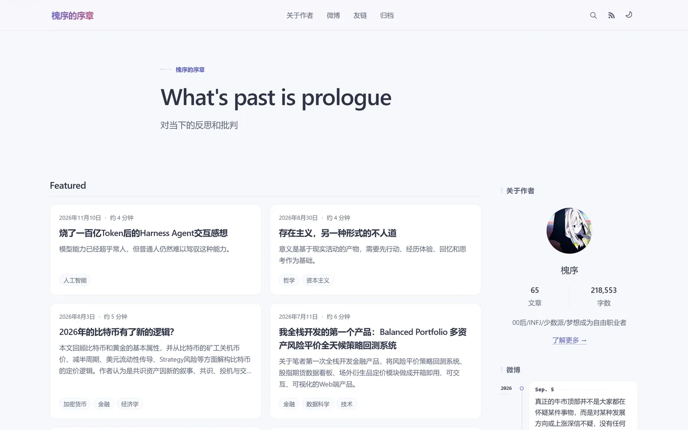
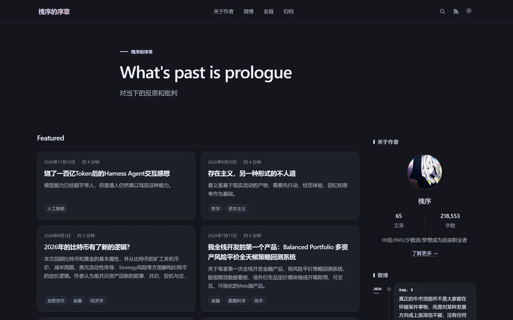
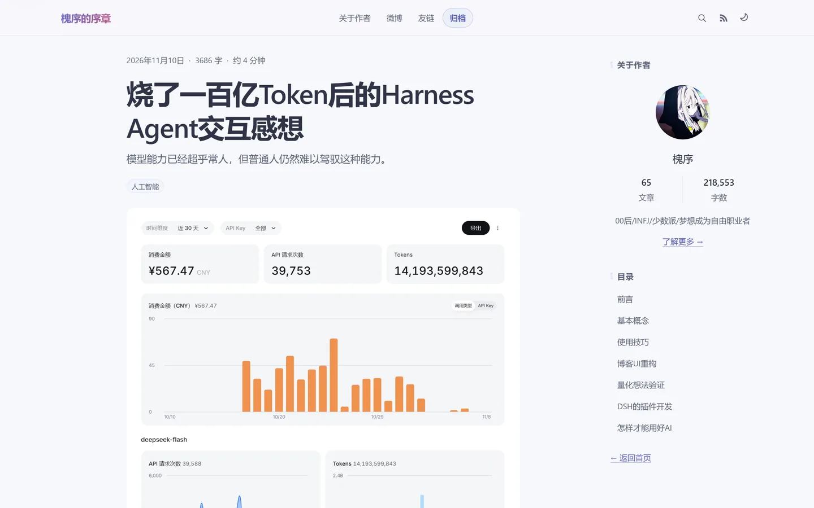
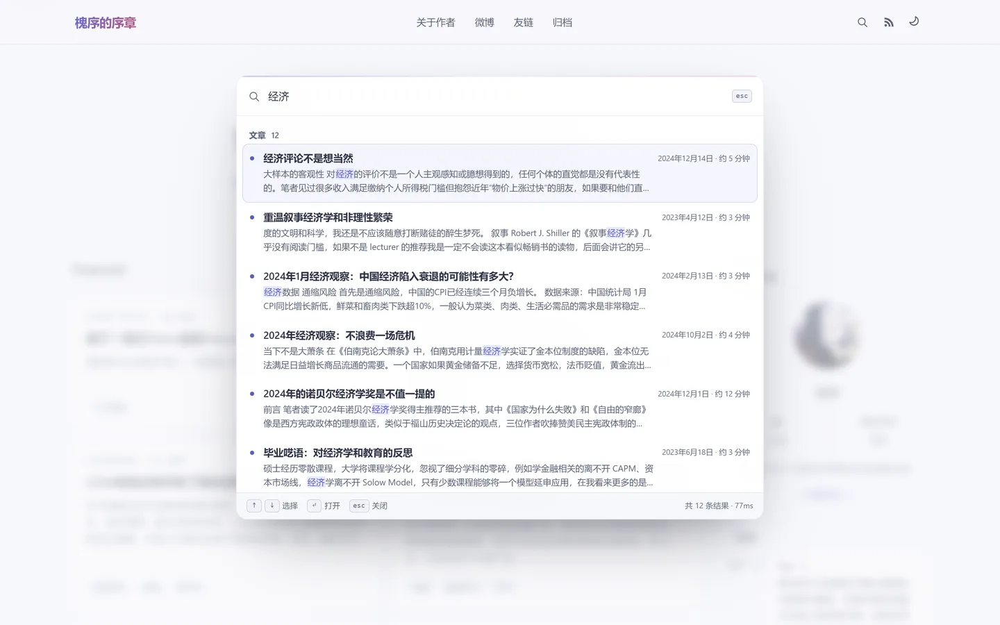
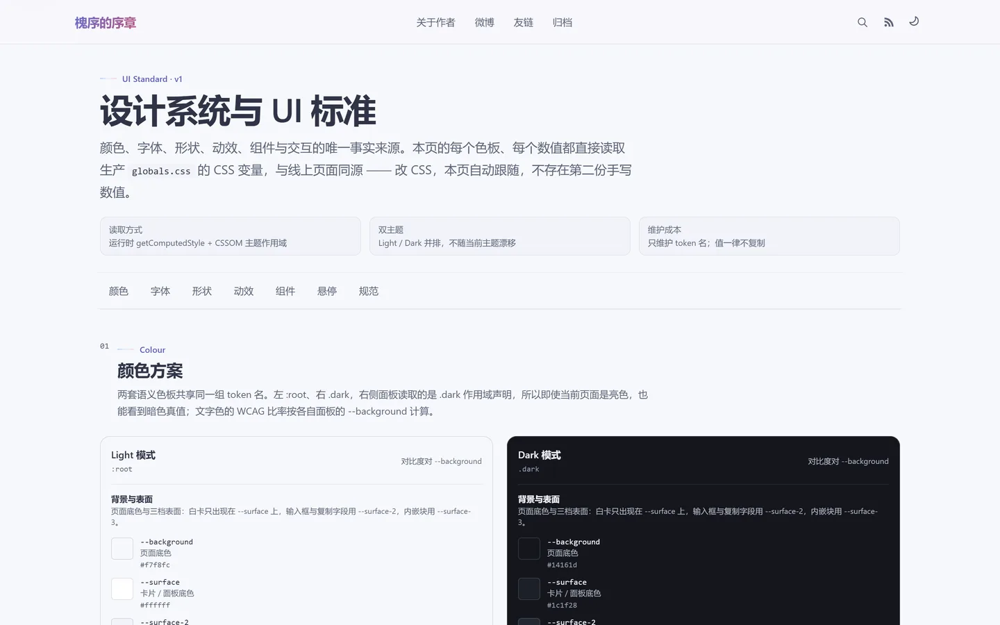
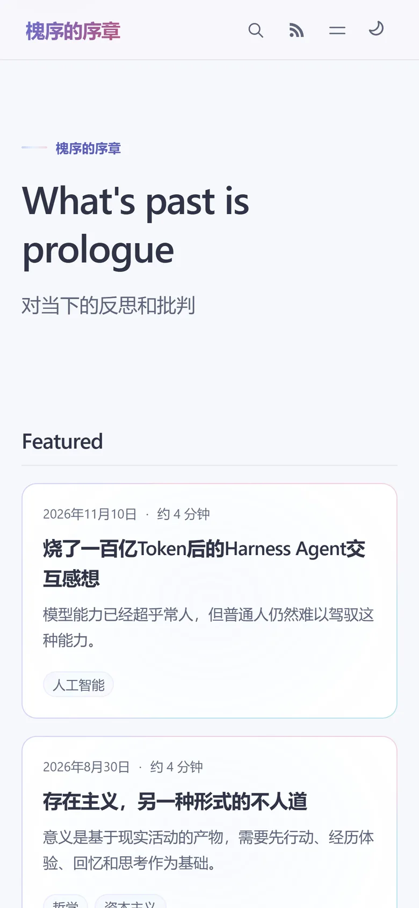
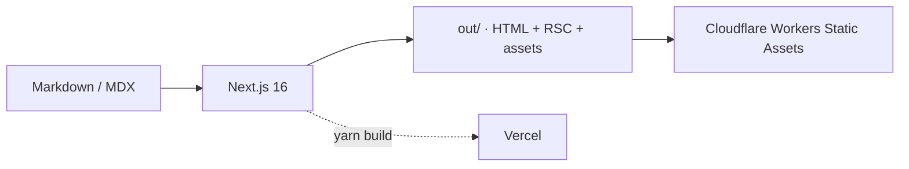

<div align="center">


# Prologue Blog

**A content-first, fully static blog built with Next.js 16 · Markdown · AVIF/WebP images · full-text search · one-click deploy to Cloudflare or Vercel**

[](https://nextjs.org)
[](https://react.dev)
[](https://tailwindcss.com)
[](https://workers.cloudflare.com)
[](https://vercel.com)
[](https://nodejs.org)
[](https://yarnpkg.com)
[](https://playwright.dev)
[](LICENSE)
[](#)

[**Live demo**](https://prologue.dev) · [**Use this template**](https://github.com/hxlog/prologue-blog-template/generate) · [中文](./README.md)

[](https://vercel.com/new/clone?repository-url=https%3A%2F%2Fgithub.com%2Fhxlog%2Fprologue-blog-template)
[](https://deploy.workers.cloudflare.com/?url=https://github.com/hxlog/prologue-blog-template)



</div>

## ✨ Features

| Capability | What you get |
|---|---|
| ✍️ **Content-first** | In-repo Markdown/MDX layer, no CMS; loud frontmatter validation |
| 🖼 **Image best practices** | Build-time **AVIF first + WebP fallback** variants; lightbox with original download |
| 🔎 **Site search** | Build-time index + client-side Fuse.js; instant lite results, full index upgrades in background |
| 🌗 **Dual themes** | Semantic design tokens, system dark mode, animated View Transition theme switch |
| 🧭 **SEO / GEO** | Static OG cards, sitemap, robots, RSS/Atom/JSON feeds, llms.txt, JSON-LD |
| 📝 **Rich content** | GFM, math, Mermaid, syntax highlighting, captions, lightbox, TOC |
| ⚡ **All static** | `output: "export"` + Cloudflare Workers Static Assets (assets-only, $0) |
| 🚀 **Two platforms** | One-click deploy on Cloudflare (production) or Vercel |

<table>
  <tr>
    <td width="50%"></td>
    <td width="50%"></td>
  </tr>
  <tr>
    <td width="50%"></td>
    <td width="50%"></td>
  </tr>
  <tr>
    <td width="50%"></td>
    <td width="50%"><b>📱 Responsive & accessible</b><br/>Mobile, dark mode, keyboard navigation, search and lightbox all work; Lighthouse A11y 100.</td>
  </tr>
</table>

## 🧱 Tech Stack

| Layer | Choice |
|---|---|
| Framework | Next.js 16 App Router · React 19 · Turbopack |
| Styling | Tailwind CSS v4 · CSS design variables (`/ui` is the living spec) |
| Content | Filesystem Markdown/MDX · unified/remark/rehype · Shiki · MathML · Mermaid |
| Search | Build-time index + Fuse.js (client only, no search API) |
| Delivery | Static export → Cloudflare Workers Static Assets / Vercel |
| Quality | Playwright E2E + Lighthouse + W3C Feed Validator |

## 🚀 Getting Started

```bash
corepack enable
yarn install
yarn dev        # http://localhost:3000
```

Edit content in `data/content/**`; site identity in `data/sitemetadata.js`. Full guide: [docs/CONTENT.md](./docs/CONTENT.md).

## ☁️ Deployment

| Cloudflare (production, recommended) | Vercel (equivalent) |
|---|---|
| Static export + assets-only Worker; free static requests, no server runtime | Native Next.js build with global CDN; great for previews and template users |
| [](https://deploy.workers.cloudflare.com/?url=https://github.com/hxlog/prologue-blog-template) | [](https://vercel.com/new/clone?repository-url=https%3A%2F%2Fgithub.com%2Fhxlog%2Fprologue-blog-template) |
| `yarn export` → `yarn deploy:cf` | `yarn build` (run automatically by Vercel) |
| [Cloudflare guide](./docs/DEPLOY-CLOUDFLARE.md) | [Vercel guide](./docs/DEPLOY-VERCEL.md) |



## ✍️ How to Use

| I want to… | Go to |
|---|---|
| Write posts / pages | `data/content/blog`, `data/content/pages` → [docs/CONTENT.md](./docs/CONTENT.md) |
| Change theme / tokens | `src/app/globals.css` → see [/ui](https://prologue.dev/ui) |
| Manage nav / links / microblog | `data/headerNavLinks.js`, `data/links.yaml`, `data/microblog.yaml` |
| Configure comments | Giscus (see `src/components` and `data/sitemetadata.js`) |
| Switch hosting | [Cloudflare](./docs/DEPLOY-CLOUDFLARE.md) / [Vercel](./docs/DEPLOY-VERCEL.md) |

## 🗂 Project Structure

```text
data/content/      # posts and pages (Markdown)
data/*.yaml|js     # navigation, links, microblog, site metadata
src/app/           # App Router routes (pages/feed/sitemap/robots/llms)
src/components/    # UI and interactions
scripts/           # build pipeline: search index, image variants, OG, static export
docs/              # deep-dive docs (content/deployment/audits)
```

## 📚 Docs & FAQ

- [Content authoring](./docs/CONTENT.md) · [Cloudflare deploy](./docs/DEPLOY-CLOUDFLARE.md) · [Vercel deploy](./docs/DEPLOY-VERCEL.md)
- Starter template: [hxlog/prologue-blog-template](https://github.com/hxlog/prologue-blog-template) (both one-click buttons point here)

<details>
<summary><b>Why generate AVIF/WebP at build time?</b></summary>

On-demand conversion burns serverless/edge CPU. Build-time variants make the site fully static, put correct srcset/sizes in HTML, and keep LCP stable at zero runtime cost.
</details>

<details>
<summary><b>Vercel vs Cloudflare?</b></summary>

Same codebase. Cloudflare uses `output: "export"` with an assets-only Worker (no server code); Vercel uses the native Next.js build. Features, SEO and OG are identical.
</details>

## License

[MIT](./LICENSE) © 槐序 · Powered by [Next.js](https://nextjs.org) & [Cloudflare](https://cloudflare.com)