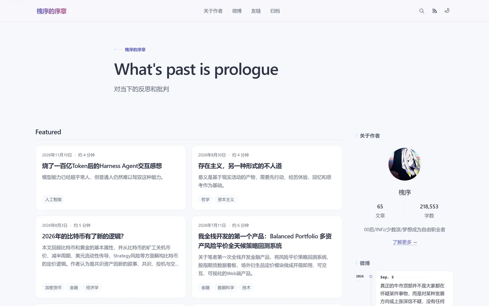
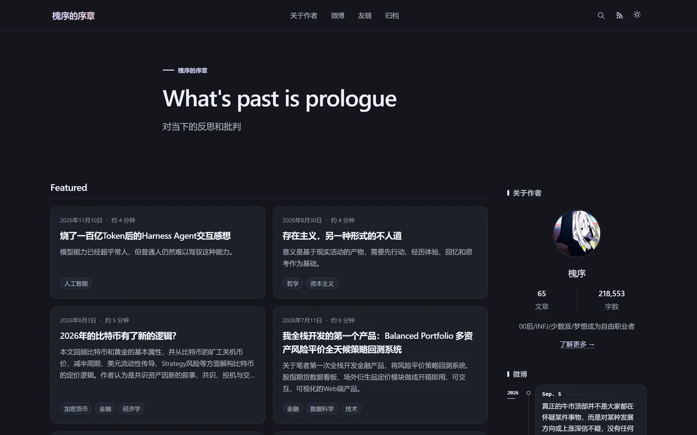
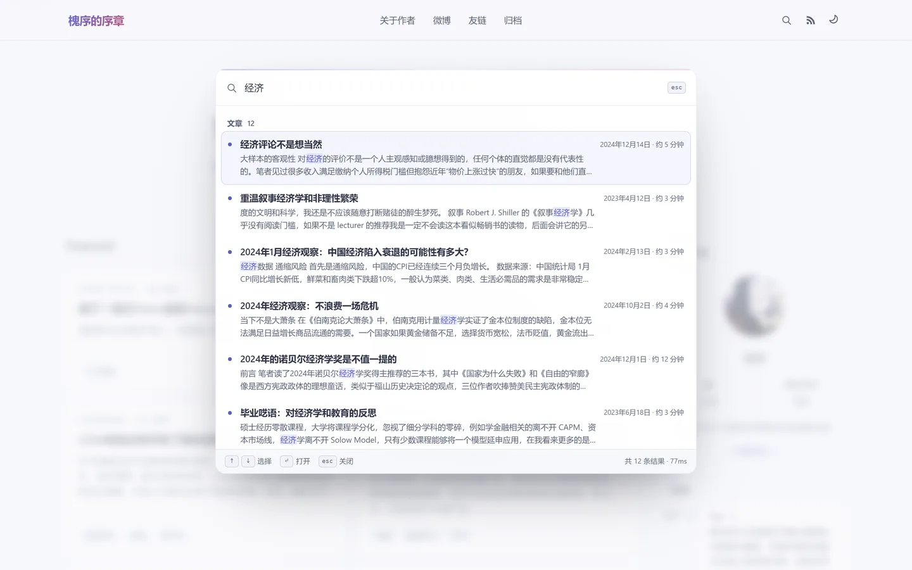
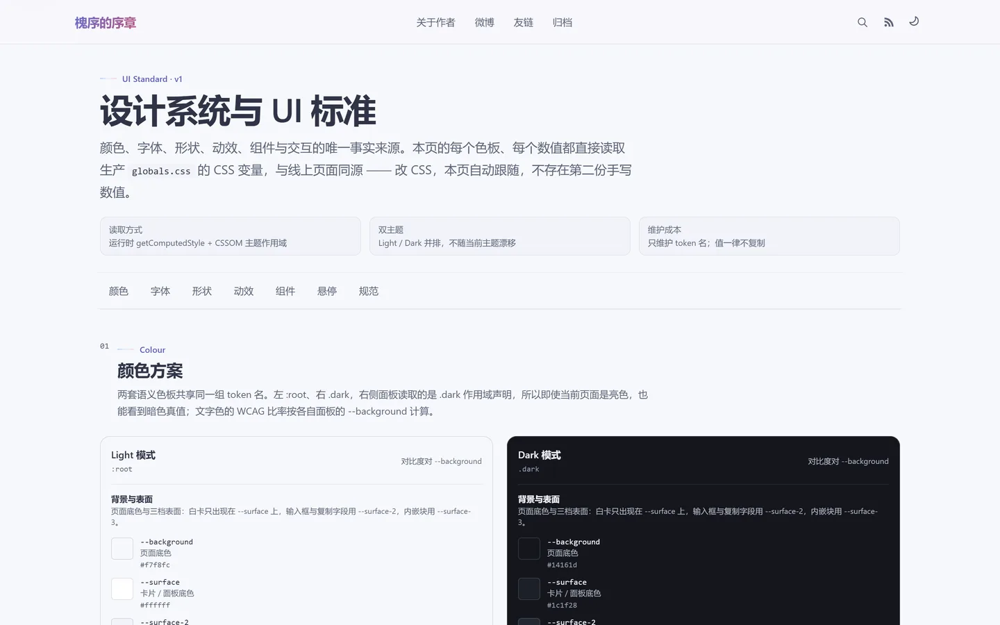
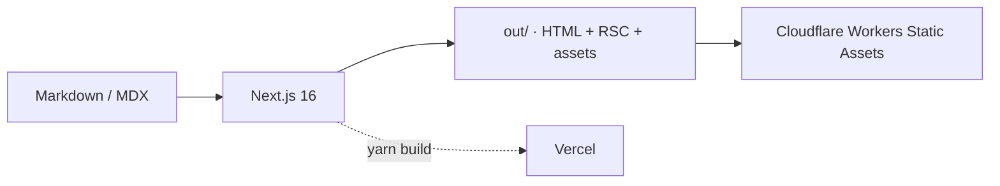

<div align="center">


# Prologue Blog

**内容优先的 Next.js 16 全静态博客 · Markdown 写作 · AVIF/WebP 图片 · 全文搜索 · 一键部署到 Cloudflare 或 Vercel**

[](https://nextjs.org)
[](https://react.dev)
[](https://tailwindcss.com)
[](https://workers.cloudflare.com)
[](https://vercel.com)
[](https://nodejs.org)
[](https://yarnpkg.com)
[](https://playwright.dev)
[](LICENSE)
[](#)

[**在线体验**](https://prologue.dev) · [**使用模板**](https://github.com/hxlog/prologue-blog-template/generate) · [English](./README.en.md)

[](https://vercel.com/new/clone?repository-url=https%3A%2F%2Fgithub.com%2Fhxlog%2Fprologue-blog-template)
[](https://deploy.workers.cloudflare.com/?url=https://github.com/hxlog/prologue-blog-template)



</div>

## ✨ 功能介绍

| 能力 | 说明 |
|---|---|
| ✍️ **内容优先** | 仓库内 Markdown/MDX 内容层，无 CMS；frontmatter 校验失败会直接报错 |
| 🖼 **图片最佳实践** | 构建期生成 **AVIF 优先 + WebP 回退** 多尺寸变体；灯箱支持下载当前图/原图 |
| 🔎 **全站搜索** | 构建期索引 + 客户端 Fuse.js；lite 索引先出结果，全量后台补齐 |
| 🌗 **双主题** | 语义化设计变量，自适应暗黑模式 + View Transition 主题切换动画 |
| 🧭 **现代 SEO/GEO** | 静态 OG 卡片、sitemap、robots、RSS/Atom/JSON Feed、llms.txt、JSON-LD |
| 📝 **富内容** | GFM、数学公式、Mermaid、代码高亮、图注、灯箱、目录 |
| ⚡ **全静态交付** | `output: "export"` + Cloudflare Workers Static Assets（assets-only、$0） |
| 🚀 **双平台部署** | Cloudflare（生产）与 Vercel（等价可选）均可一键部署 |

<table>
  <tr>
    <td width="50%"></td>
    <td width="50%"></td>
  </tr>
  <tr>
    <td width="50%"></td>
    <td width="50%"></td>
  </tr>
  <tr>
    <td width="50%"></td>
    <td width="50%"><b>📱 响应式 & 可访问性</b><br/>移动端、暗黑模式、键盘导航、搜索与灯箱一致可用；Lighthouse A11y 100。</td>
  </tr>
</table>

## 🧱 技术栈

| 层 | 选型 |
|---|---|
| 框架 | Next.js 16 App Router · React 19 · Turbopack |
| 样式 | Tailwind CSS v4 · CSS 设计变量（`/ui` 即规范页） |
| 内容 | 文件系统 Markdown/MDX · unified/remark/rehype · Shiki · MathML · Mermaid |
| 搜索 | 构建期索引 + Fuse.js（客户端，无搜索 API） |
| 交付 | 全静态导出 → Cloudflare Workers Static Assets / Vercel |
| 测试 | Playwright E2E + Lighthouse + W3C Feed Validator |

## 🚀 Getting Started

```bash
corepack enable
yarn install
yarn dev        # http://localhost:3000
```

改内容：编辑 `data/content/**`；改站点信息：`data/sitemetadata.js`；完整说明见 [内容指南](./docs/CONTENT.md)。

## ☁️ 部署

| Cloudflare（生产，推荐） | Vercel（等价可选） |
|---|---|
| 全静态导出 + assets-only Worker，静态请求免费、无服务端运行时代码 | 原生 Next.js 构建，自动 CDN；适合快速预览与模板用户 |
| [](https://deploy.workers.cloudflare.com/?url=https://github.com/hxlog/prologue-blog-template) | [](https://vercel.com/new/clone?repository-url=https%3A%2F%2Fgithub.com%2Fhxlog%2Fprologue-blog-template) |
| `yarn export` → `yarn deploy:cf` | `yarn build`（Vercel 自动执行） |
| 详见 [部署文档](./docs/DEPLOY-CLOUDFLARE.md) | 详见 [Vercel 文档](./docs/DEPLOY-VERCEL.md) |



## ✍️ 如何使用

| 我想… | 去哪里 |
|---|---|
| 写文章 / 改页面 | `data/content/blog`、`data/content/pages` → [docs/CONTENT.md](./docs/CONTENT.md) |
| 改主题 / 设计变量 | `src/app/globals.css` → 打开 [/ui](https://prologue.dev/ui) 查看实时规范 |
| 管理导航 / 友链 / 微博 | `data/headerNavLinks.js`、`data/links.yaml`、`data/microblog.yaml` |
| 配置评论 | Giscus（见 `src/components` 与 `data/sitemetadata.js`） |
| 换部署平台 | [Cloudflare](./docs/DEPLOY-CLOUDFLARE.md) / [Vercel](./docs/DEPLOY-VERCEL.md) |

## 🗂 项目结构

```text
data/content/      # 文章与页面（Markdown）
data/*.yaml|js     # 导航、友链、微博、站点元信息
src/app/           # App Router 路由（页面/feed/sitemap/robots/llms）
src/components/    # UI 组件与交互
scripts/           # 构建流水线：搜索索引、图片变体、OG、静态导出
docs/              # 深度文档（内容/部署/审计）
```

## 📚 文档与 FAQ

- [内容写作](./docs/CONTENT.md) · [Cloudflare 部署](./docs/DEPLOY-CLOUDFLARE.md) · [Vercel 部署](./docs/DEPLOY-VERCEL.md)
- 模板仓库：[hxlog/prologue-blog-template](https://github.com/hxlog/prologue-blog-template)（Vercel / Cloudflare 一键部署按钮均指向模板）

<details>
<summary><b>为什么图片要在构建期生成 AVIF/WebP？</b></summary>

请求时生成会占用服务端/边缘 CPU；构建期生成可以完全静态化，并把正确的 srcset/尺寸写进 HTML，LCP 更稳、成本为 0。
</details>

<details>
<summary><b>Vercel 与 Cloudflare 的差异？</b></summary>

两者跑的是同一份站点代码；Cloudflare 走 `output: "export"` 的 assets-only Worker（无服务端代码），Vercel 走原生 Next 构建。功能、SEO、OG 完全一致。
</details>

## License

[MIT](./LICENSE) © 槐序 · Powered by [Next.js](https://nextjs.org) & [Cloudflare](https://cloudflare.com)