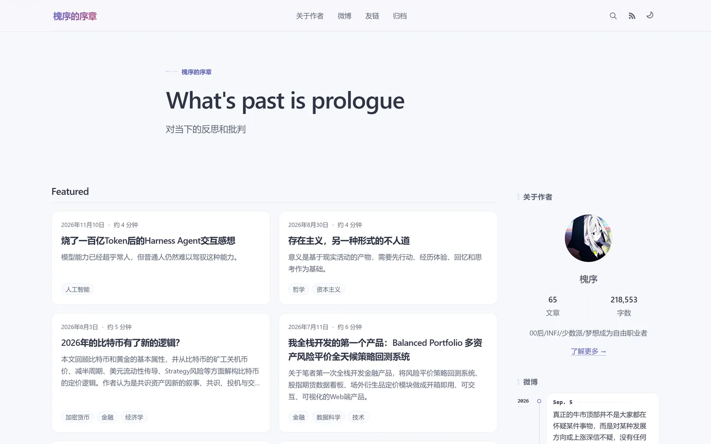
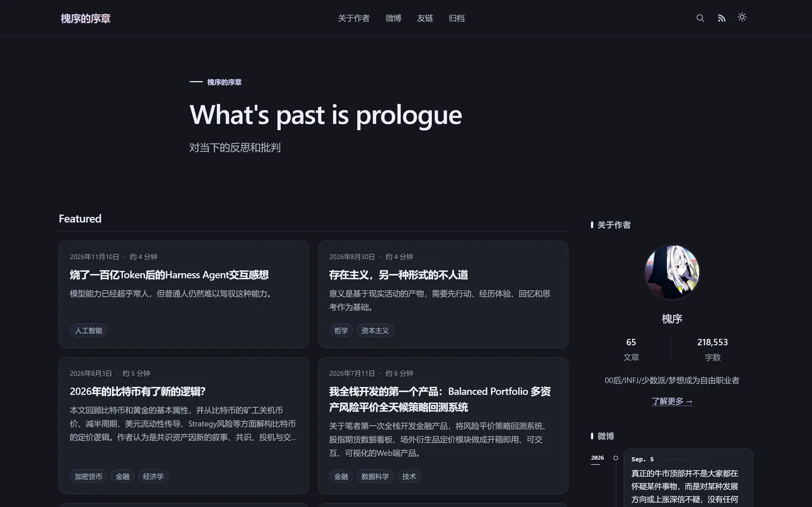
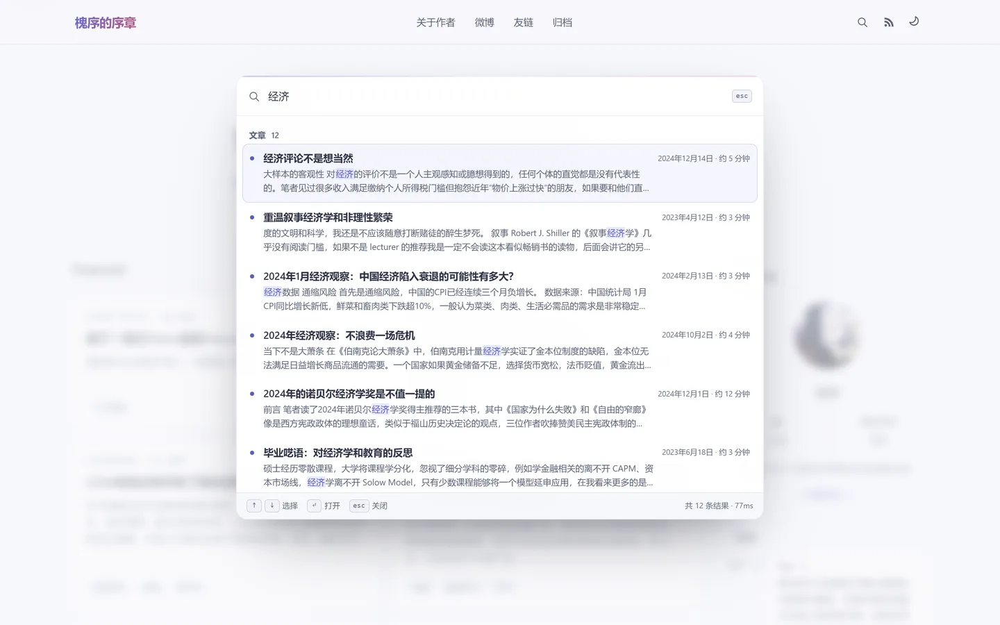
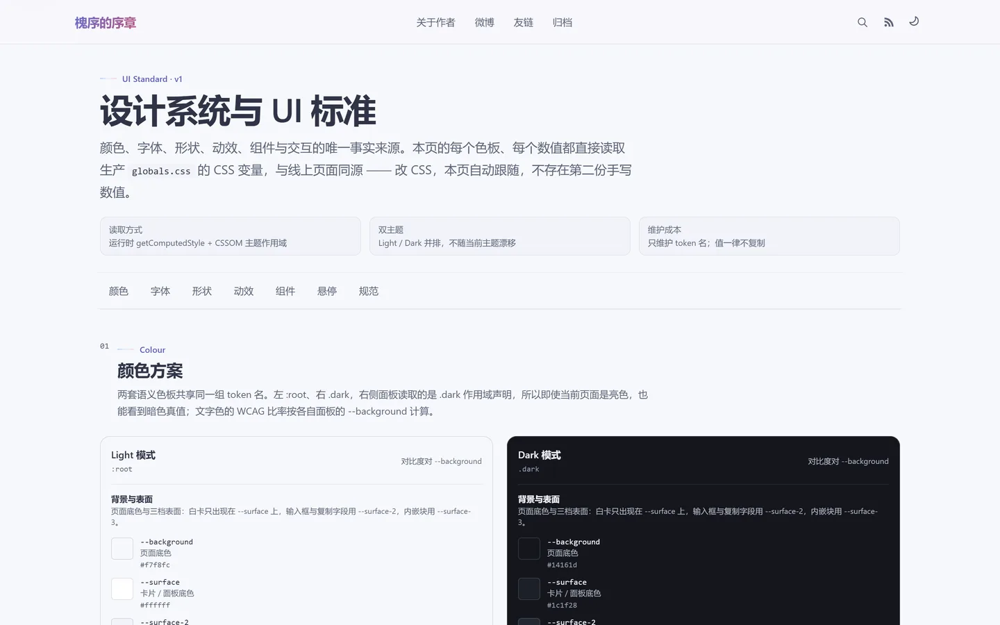
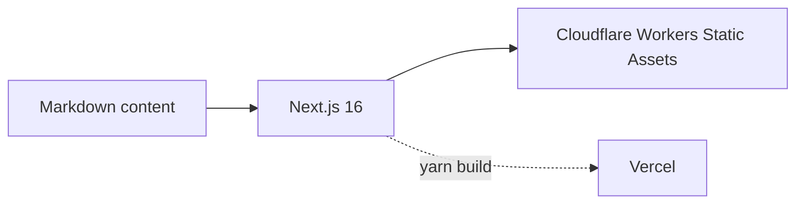

<div align="center">


# Prologue Blog Template

**A content-first, fully static blog starter · Next.js 16 · Markdown · AVIF/WebP · search · deploy to Cloudflare or Vercel**

[](https://nextjs.org)
[](https://react.dev)
[](https://tailwindcss.com)
[](https://workers.cloudflare.com)
[](https://vercel.com)
[](LICENSE)

[**Live demo**](https://prologue.dev) · [中文说明](#中文说明) · [](https://github.com/hxlog/prologue-blog-template/generate)

[](https://vercel.com/new/clone?repository-url=https%3A%2F%2Fgithub.com%2Fhxlog%2Fprologue-blog-template)
[](https://deploy.workers.cloudflare.com/?url=https://github.com/hxlog/prologue-blog-template)



</div>

## ✨ Features

| Capability | What you get |
|---|---|
| ✍️ Markdown-first | Edit `data/content/**`, no CMS, loud frontmatter validation |
| 🖼 Images | Build-time AVIF + WebP variants, lightbox with original download |
| 🔎 Search | Build-time index + client Fuse.js (no search API) |
| 🌗 Themes | Semantic tokens, dark mode, View Transition animations |
| 🧭 SEO/GEO | OG cards, sitemap, robots, RSS/Atom/JSON, llms.txt, JSON-LD |
| 📝 Rich content | GFM, math, Mermaid, Shiki, captions, TOC |
| ⚡ Static | `output: "export"` for Cloudflare, native build for Vercel |
| 🚀 Deploy | One-click on both platforms |

<table>
  <tr><td width="50%"></td><td width="50%"></td></tr>
  <tr><td width="50%"></td><td width="50%"></td></tr>
</table>

## 🚀 Getting Started

```bash
corepack enable
yarn install
yarn dev        # http://localhost:3000
```

Edit `data/content/**` for posts, `data/sitemetadata.js` for site identity, `src/app/globals.css` for design tokens. Full guide: [docs/CONTENT.md](https://github.com/hxlog/prologue.dev/blob/master/docs/CONTENT.md).

## ☁️ Deploy

| Cloudflare | Vercel |
|---|---|
| [](https://deploy.workers.cloudflare.com/?url=https://github.com/hxlog/prologue-blog-template) | [](https://vercel.com/new/clone?repository-url=https%3A%2F%2Fgithub.com%2Fhxlog%2Fprologue-blog-template) |
| `yarn export` → `yarn deploy:cf` | `yarn build` (Vercel auto-runs it) |



## ✍️ Usage

| I want to… | Go to |
|---|---|
| Write a post | `data/content/blog` |
| Change site identity | `data/sitemetadata.js` |
| Change design tokens | `src/app/globals.css`, preview at `/ui` |
| Nav / links / microblog | `data/headerNavLinks.js`, `data/links.yaml`, `data/microblog.yaml` |
| Comments | Giscus (see `src/components`) |

## 📚 Docs

- [Content authoring](https://github.com/hxlog/prologue.dev/blob/master/docs/CONTENT.md) · [Cloudflare deploy](https://github.com/hxlog/prologue.dev/blob/master/docs/DEPLOY-CLOUDFLARE.md) · [Vercel deploy](https://github.com/hxlog/prologue.dev/blob/master/docs/DEPLOY-VERCEL.md)

## 中文说明

<details open>
<summary>中文快速开始</summary>

- **在线示例**：[prologue.dev](https://prologue.dev)
- **一键部署**：上方 Vercel / Cloudflare 按钮会克隆本模板仓库
- **本地开发**：`corepack enable && yarn install && yarn dev`
- **写内容**：`data/content/blog`（文章）、`data/content/pages`（页面）；站点信息在 `data/sitemetadata.js`
- **部署 Cloudflare**：`yarn export` 后 `yarn deploy:cf`（assets-only Worker，静态请求免费）
- **部署 Vercel**：直接导入仓库，构建命令 `yarn build`
- 详细文档：[内容](https://github.com/hxlog/prologue.dev/blob/master/docs/CONTENT.md) · [Cloudflare](https://github.com/hxlog/prologue.dev/blob/master/docs/DEPLOY-CLOUDFLARE.md) · [Vercel](https://github.com/hxlog/prologue.dev/blob/master/docs/DEPLOY-VERCEL.md)

</details>

## License

[MIT](./LICENSE)