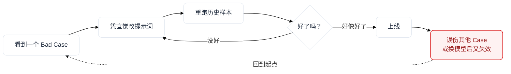
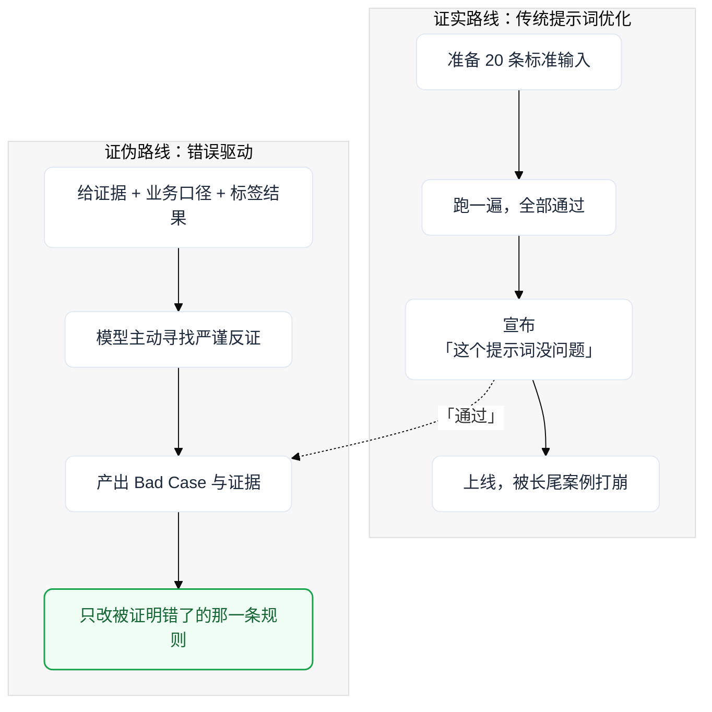

> 以下文章源自笔者一次关于AI数据标注内容的技术分享的公开演讲

数据标注是数据生产中最基础的一环，而大模型的普及正在改变它的实现方式：不少团队开始让模型批量打标，把非结构化原文加工成标准化的标签 JSON。问题也随之而来——模型打得对不对？如果没有足够的人力做抽样验收，质量评估与提示词改进能不能用工程化的方式完成？

本文沿着三个问题展开：如何科学地改进模型标注的提示词、如何科学地评估模型标签的准确率，以及为什么在缺少完整金标的条件下，刻画标签质量更适合去「证伪」，而不是统计一个孤立的准确率。

## 模型标注的问题

### 什么是模型打标

数据标注是指对图片、文本、视频等结构化与非结构化数据进行处理，标记对象的特征与符号。例如文本情感分析、文本枚举分类、信息提取，具体来讲，比如从一份研报里抽取事件的枚举主题与分类字段，或者从会议纪要里提取关联题材。

以往大多依赖无监督学习（如聚类）、有监督学习（分类器）、字符串/分词/正则匹配、人工标注这四种方法。这些方法并没有消失，只是现在多了一种更灵活的方式：让大模型批量完成标注。

大模型自动化标注（模型打标），是指批量调用大模型的对话，把非结构化数据、Skills、提示词、上下文传入，最终稳定输出标准化标签 JSON 的过程。它的整体结构如下图所示。

问题是：采用了大模型批量打标之后，标签打得对不对，大多数团队仍要靠人工抽检来验收；如果没有这样的人力物力，能不能从软件工程的角度实现自动化的 Review 检验与 Improve 改进？这就是本文想讨论的内容，具体包括三个问题：

1. 如何科学改进用于模型标注的提示词：编程而非提示；
2. 科学评估模型标签准确率；
3. 为什么刻画模型标签准确率更适合去证伪，而不是统计准确率。

## 模型标注提示词的改进

遇到模型输出不及预期，大部分人都会使用以下提示词优化方法：

| 问题 | 具体表现 | 解决方案 |
| --- | --- | --- |
| **提示词过于零碎，表达不充分** | 套模板（如 CRISPE 框架），描述清楚字段业务含义，标准化输入输出，适当增加规则 | 结构规范化 + 指令优化 |
| **上下文供给不足** | 外部数据是否 ETL 到位、临时表是否对齐、JSON 是否正确传入、要不要开联网搜索、联网搜索是否指定了搜索内容、按需联网还是强制联网 | 想清楚喂哪些上下文进单轮对话 |
| **思维链（CoT）与 Skills 冗余妨碍模型能力** | 随着模型迭代，大部分旧 Skills 和思维链能力已被内化 | 宁缺毋滥，能删就删，写清楚业务字段口径即可 |
| **约束与规则的写法** | 写「不要 XXX」反而让模型更往那个方向想 | 改成正向陈述标准 |
| **请求参数** | effort / temperature / top-p / top-k / 词频惩罚 / batch 批次 | 全局参数调整，根据模型实际输出情况调试 |

冗余本身也在伤害模型：Transformer 的注意力是 softmax 归一化，新增 token 会改变权重分配，相关 token 之间会相互竞争；旧技巧堆得越多，真正重要的字段口径反而越容易被淹没。

以上这些旧的提示词方法，可优化的方向太多，就像一个黑盒，且不好诊断，具体表现在以下场景：

- **针对 Bad Case 的直觉调参**：提示词凭感觉改，可能只是在局部「刚好能用」，而非最优解；凭理解瞎调、重跑历史样本、人工注释金标、A/B 对照，费时费力，还可能误伤其他本来正确的 Case，后期还得补规则比对。

- **模型版本升级**：换到新模型后，旧提示词的效果反而变差，一套提示词可能只在某个系列模型上适用，需要重新评估它在不同模型上的适用性。

费尽心思调整出来的提示词，可能只是刚好能用，而不是最优解。提示词的优劣原本是一个可以被度量的东西，我们缺少的只是度量它、搜索它的手段——这正是提示词优化工具要解决的问题。

## 科学优化提示词的方法

提示词优化有两条截然不同的路线：一条在有标准答案的前提下，让程序自动搜索更优的指令与示例；另一条则放弃寻找「标准答案」，转而把模型犯过的错误作为优化信号。下面分别来看。

### 基于金标集的优化方法

DSPy 是由斯坦福大学自然语言处理小组开发的提示词框架，它主打「编程，而不是提示」，是一种使用 LLM 进行构建的声明式方法，将任务描述为结构化的输入和输出。它不需要手动修改提示词，而是使用「**声明程序 + 编译程序**」的方式。

它的几个核心概念构成了一套最小抽象：

| 原语 | 类比 | 作用 |
| --- | --- | --- |
| **Signature（签名）** | 函数签名 | 声明任务契约：任务描述（字段业务含义）、输入输出的类型以及预期行为，只说什么进、什么出，不管措辞 |
| **Module（模块）** | 函数体 | 构建与语言模型交互的程序的基本单元，经过通用化处理，可以接受任何签名，同时抽象出 few-shot、思维链等提示技术 |
| **Example（样本）** | 测试用例 | 训练集与验证集样本，在有监督场景中附带参考输出 |
| **Metric（度量）** | 损失函数 | 衡量当前输出数据质量好坏的度量指标，决定什么叫「更好」 |
| **Optimizer（优化器）** | 编译器 | 利用带注释的输入输出样本提升模块性能，可以自动改进提示与少样本示例，生成性能更优的新模块，如 BootstrapFewShot、MIPROv2、GEPA |

以 **MIPROv2** 这个优化器为例，它可以同时优化指令和少样本示例，大致分三步：

1. **Bootstrap few-shot 候选**：自举法重抽样，跑训练集，为签名生成 few-shot 的候选集；
2. **Propose instructions 提出指令**：把「训练集摘要 + 程序代码与该 predictor 的职责 + bootstrap 出的输入输出样例 + 一个随机 tip」喂给用于生成和优化指令的 LLM（prompt model），批量生成人类可读的新指令；
3. **Bayesian Optimization 选组合**：在（指令候选 × 示范候选）的笛卡尔积上探索，贝叶斯优化会根据已经试过的组合和得分，推测哪些还没试过的组合更有可能得高分；每轮先在小批量上评估，再在完整验证集上复核。

最终，优化器把表现最好的指令和示例配置到对应的 Predictor 上；程序运行时，Adapter 根据签名、指令、示例和当前输入，动态构造出发送给 LLM 的最终提示词。也就是说，有了 DSPy 这套框架，我们只需要维护好字段定义、数据集、反馈函数，就能自动生成提示词。

那么，提示词优化具体在优化什么？主要就是两件事：

- **Few-shot 示例**：优化器可以添加、移除或修改模型在推理期间参考的示例，这是成本最低的优化方式；添加示例时，优化器不会改动整个提示，只是把示例放进提示的「辅助信息」部分；
- **用户指令**：MIPROv2、SIMBA、GEPA 等优化器可以重写提示中的任务指令。算法探索的空间比人脑大得多，能找到比人工措辞更优的语句，比如更清晰的任务分解、边界条件和验收标准。

所以，只需要给出签名（任务描述）和有一定样本数量的训练集，就能自动生成出 Few Shots 和指令。

适用场景：

- 适用于有标准答案的打标任务，能够人工标注的训练集，且存在一个度量指标衡量准确率或好坏；
- 输入输出高度结构化，输出标签大多在枚举值范围内，且大多不存在歧义。

缺陷：

- 依赖度量指标的合理性；
- 对有歧义的字段敏感。

### 基于错误优化的方法：GEPA

GEPA 将提示词优化过程视为一个进化过程，我把它称作基于错误的帕累托优化方法——一种「通过反思自然语言中信息的序列化轨迹（例如指令、推理步骤、工具调用等）来有意识地学习自然语言」的算法。它的特别之处在于：除了标量分数，还把「这个样本为什么得分低、违反了哪条约束」这样的自然语言反馈，一并交给反思模型。分数负责判断好坏，反馈负责解释原因，以及下一版提示词应该改什么。

它先从初始化系统的「候选池」开始，池中包含多个初始提示词；然后在不同任务上测试，挑出每个任务表现最好的候选，送入「帕累托前沿（过滤池）」，避免单一指标过拟合。帕累托改进指的是，在没有使任何人境况变坏的前提下，使得至少一个人变得更好——在这里，就是让这个提示词尽可能通过更多的测试案例。

接着是反思式变异：结合训练数据，让大模型反思这些优秀提示的不足，变异生成一个新的候选者；随后进入训练集检验。这个「挑选—反思—测试」的循环会一直运转，直到预算耗尽。简单来说，就是让 AI 不断反思错题，并尽可能适应不同类型的任务。

这两种方法论都被内置在 DSPy 这个包里，它还提供 ReAct 等模块；但 ReAct 是一种程序/模块范式，不等于 GEPA 这样的优化器。这里重点讲的是两种优化方法论本身，小结如下：

|  | 提高准确率（拟合金标） | 降低错误率（通过错误案例去修复） |
| --- | --- | --- |
| **隐含前提** | 有标准答案，能算出「对了百分之多少」 | 没有标准答案，但「哪些是明显错的」可以独立判定 |
| **需要什么** | 金标库、人工抽检、交叉验证 | 证据（原文）+ 业务口径 + 一个会挑错的审判者 |
| **指标形态** | 精确率 / 召回率 / F1 / AUC | 「标量分数 + 文本反馈」的复合体 |
| **投入方向** | 证明真 | 让模型少犯明显的错误 |
| **对应假设检验错误** | 同时涉及一类/二类错误。若阳性=错误：精确率偏控一类错误（实际正确却判错） | GEPA 防的是二类错误（实际错误却判成正确，漏掉明显错误），同时用业务口径和审判者控制一类错误（实际正确却误判为错误，误伤） |

这两种方法都能显著改善准确率，而不是凭直觉瞎改提示词。它们的共同点是：先把「什么算更好」定义清楚，再让程序去搜索、去迭代，而不是让一个黑盒去碰运气。

## 基于统计学原理的 A/B 对照测试

**如果我们想换新的模型或新的提示词，怎么知道是否真的有改善？**

我们最初借鉴了模型蒸馏中教师-学生模型的角色分工，以及前面 DSPy 的思路：建立训练集和统计准确率，用一个更强的海外模型和一个性价比较高的国产模型，对同一任务进行同时标注，最终以教师模型的输出作为金标，来获得以下统计值：

| 步骤 | 内容 |
| --- | --- |
| **① 原假设 H₀** | 新提示词（或新模型）**并不比**旧的更好（两个比例无差异） |
| **② 备选假设 H₁** | 若只关心「有没有变好」，用**单侧** H₁：新的更好；若只关心「有没有变」，用**双侧** H₁：两者有差异 |
| **③ 计算统计值** | 独立样本用两比例 **z 检验** |
| **④ 是否拒绝 H₀** | 双侧 α = 0.05：$\lvert z \rvert > 1.96$ 拒绝 H₀；单侧：$z > 1.645$；否则不显著 |

先把混淆矩阵里的四个格子说清楚：**TP**（真正例，标出来了并且标对）、**FN**（假负例，该标没标，漏召回）、**FP**（假正例，不该标却标了，误报 / 无中生有）、**TN**（真负例，没标，本来也不该标）。常用的指标如下：

| 指标 | 公式 | 一句话含义 |
| --- | --- | --- |
| **召回率（真阳性率）** | $TP / (TP + FN)$ | 真实正例里，有多少被找出来——漏召回的计量 |
| **精确率** | $TP / (TP + FP)$ | 判为正的里面，有多少是真的——误报的计量 |
| **假正率** | $FP / (FP + TN)$ | 真实为负的里面，被误判为正的比例 |
| **F1** | $2PR / (P + R)$ | 精确率与召回率的调和平均 |
| **准确率** | $(TP + TN) / (TP + FP + FN + TN)$ | 整体正确率 |

由于没有人工标注的金标做锚，这套流程必然存在以下问题：

|  | 含义 | 代价 |
| --- | --- | --- |
| **一类错误 α（假阳性）** | H₀ 为真却拒绝了它 | 上线了一个其实没变好的模型 |
| **二类错误 β（假阴性）** | 真有提升却判成没提升 | 错过收益，把好模型换掉 |

以上方法论适用于模型平替这类场景：想换成更廉价的模型，统计准确率会受影响多少，一次 A/B 对照测试就能给出量化答案。但实际上，单一的标签准确率并不能很好地覆盖模型标签出错的真实情况。

## 标签错误的真实形态

真实的生产数据里，标签错误至少有六种形态，它们各自对应不同的计量方式与业务后果：

| 形态 | 具体表现 | 常用计量 | 业务后果 |
| --- | --- | --- | --- |
| **漏召回** | 本该标出来的，没标出来 | 召回率 = $TP / (TP + FN)$ | 标签缺失 |
| **误报 / 无中生有** | 标出来了一堆，但其中很多并不成立 | 精确率 = $TP / (TP + FP)$ | 噪音污染下游，大概率是模型幻觉 |
| **张冠李戴（错位）** | 值本身是对的，但挂到了错误的主体、时间或位置上 | 难以用传统指标表达 | 最危险：格式合法、字面全对、语义错 |
| **格式与契约违规** | JSON 不合法、枚举值超出白名单、该给数组却给了字符串 | 结构合法率 | 下游解析直接失败或静默丢字段；常见于上下文过长，一般通过多次重试打标解决 |
| **口径偏离** | 标的内容没错，但不符合业务定义 | 需人工或裁判判定 | 数据「能用但不对味」 |
| **标注歧义** | 就算是人工标注，都可能标不一致，标准本身模糊 | 标注者间一致性（Kappa 一致性检验） | 字段定义不清晰或存在歧义，同义标签随机打标 |

所以，评估系统不能只有一个总分，而要把错误按类型拆开：结构问题可以自动校验，事实问题要看证据，口径问题要看业务定义，歧义问题要先回到标注规范。这也解释了为什么「一个准确率数字」在工程上是远远不够的。

## 如何监控准确率

### 最初的设计与它的硬伤

最初的设计是：**用更强的海外 T0 梯队模型重复打标，默认海外模型打出的就是金标**，再按任务类型统计准确率、召回率、相似度匹配、F1、bootstrap 等统计值。但这套设计有几处硬伤：

| 硬伤 | 说明 |
| --- | --- |
| **「更贵的模型」≠ 金标准** | 我们在打标上用的模型，在「输出严格 JSON」这一场景本身就处于第一梯队，无证据表明更贵的海外模型更强。把更贵模型的输出当金标，没有统计学依据。 |
| **场景没有划分** | 有的任务该用向量相似度，有的只查枚举白名单，有的根本不需要 F1。一套指标硬套所有任务，等于都没适配。 |
| **没有人工金标做锚** | 没有人工抽检金标作锚，召回率 / F1 / AUC 算出来也无意义——它们只是两组模型之间的互相打分。 |
| **模型会「共谋」犯错** | 两个模型很可能存在教师-学生的蒸馏关系或共享相似的训练数据，遇到同一个难例会一起错：两方一致只能说明稳定，不能说明正确。 |

而现实约束恰恰是：

- 没有人力物力去搭建金标库；
- 没有常态化的人工抽检；
- 新任务上线前没有交叉验证；
- 部分标签候选本身存在摇摆——枚举字段有歧义，人工标注也不一定能完全做对。

### 三条可行的路径

围绕「没有完整金标时如何评估标签质量」，我们梳理出三条可行路径：

| 评估模型标签准确率的方法论 | 思路 |
| --- | --- |
| **模型 Review 找 Bad Case** | 只提供字段含义和标签结果，删除所有思维链和中间指令，让另一个模型专门只找错，且这个错误必须有证据——即把原假设给证伪了 |
| **教师-学生模型重复打标交叉检验** | 符合大数定律，通过传统统计学的指标进行测量，**必须真的抽足够多的、彼此独立的样本** |
| **标签输出后走一次检验才可落库** | 所有模型标注在出去之前都必须经过模型 Review 证真；代价是容易误伤，造成漏召回 |

三种方法都可行，但经过我的长期测试，让模型去「证伪」，比让它去「证真」更有可行性。

### 从「证实」到「证伪」

以上我们都在讲怎么把提示词或模型的评估与改进做得更科学与严谨。但即使把统计做对了，还有一个更根本的问题：**我们到底在证明什么？**

> 卡尔·波普尔在《科学发现的逻辑》中提出：科学知识无法通过「证实」来归纳，只能通过「证伪」来检验。一个理论如果无法被证伪，就不是科学理论；一个理论越容易被证伪、却又经受住了严格的检验，它就越坚实。

把这句话翻译到提示词工程：

> **传统的提示词优化是一种证实陷阱。** 我们准备 20 条标准输入，跑一遍提示词，全部通过，于是宣布「这个提示词没问题」。这个动作在逻辑上做的是**归纳证实**——它永远无法证明提示词是对的，只能证明「在这 20 条上还没错」。而真实数据进入产线的那一刻，它面对的是一万种你没见过的形态。

基于 GEPA 优化提示词找错改进指令的思路和波普尔证伪理论的启发，我们意识到：应该专注惩罚第二类错误（本来有错，却判定为正确），而不是把主要精力花在第一类错误（本来正确，却判定为错误）上。落到工程上，就是三处转变：

| 步骤 | 做什么 | 最终效果 |
| --- | --- | --- |
| **换目标函数** | 从「精确率」转向「**错误率**」 | 错误率**不需要金标**，只需要证据 |
| **换判定方式** | LLM as a Judge：让 Agent 扮演**批判性的检验者**，只给证据原文、业务含义、标签结果，开联网搜索并给上下文，**去掉中间产物与思维链**，要求「**只有严谨证据证明是错的才算错**」 | 去掉思维链，是为了防止裁判被候选答案的推理**锚定** |
| **换产出物** | 不看一个总分，而是看**一份自然语言描述的 Bad Case 清单**，交给开发者按 GEPA 的方式去改提示词，也可以直接套用 DSPy + GEPA 去改进提示词 | 形成自动化找错并改进提示词的闭环 |

### 平台落地：证据驱动的错误发现闭环

基于上面这一整套方法论，我们开发并部署了一个数据标签校验监控平台，专门去给生产环境里的模型标签跑「证明为假」这件事：平台会重新调取原文、业务口径和必要的外部证据，对每个字段独立裁定，只有当证据足以证明标签错误时才判错，并把每一处确定的错误连同证据整理成 Bad Case 清单，提醒对应的开发者据此改进提示词。跑通之后，「科学改进提示词、评估模型标签准确率、主动监测模型标签质量」就不再是三个孤立的环节，而是一个可以持续运转的闭环。

我认为模型打标这个场景非常适合做提示词优化，从而增强它的准确率和鲁棒性。

## 小结

总结一下，本文讲了三件事：

- 通过 DSPy 与 GEPA 优化提示词，让模型打标不再是黑盒，而是可以编译、可以搜索、可以用错误反馈迭代的程序；
- 用统计学方法做模型之间的 A/B 对照测试，评估模型与提示词的绩效；
- 用模型审判找错来自动监测标签质量，以错误证据驱动提示词改进。

模型打标不是一份「一次写对」的提示词能够解决的问题，它更像一条产线：有输入契约、有质量度量、有反馈回路。希望这套方法论能对大家使用 AI 有一点帮助——让提示词优化不再靠直觉，也让「模型到底打得对不对」从一句模糊的质疑，变成一组可以验证、可以追踪、可以持续改进的工程问题。

## 参考资料

- DSPy：Programming—not prompting（[dspy.ai](https://dspy.ai)），及论文 *DSPy: Compiling Declarative Language Model Calls into Self-Improving Pipelines*（arXiv:2310.03714）；
- GEPA：*GEPA: Reflective Prompt Evolution Can Outperform Reinforcement Learning*（arXiv:2507.19457）；
- MIPROv2 优化器：见 DSPy 官方文档；
- 卡尔·波普尔：《科学发现的逻辑》。
